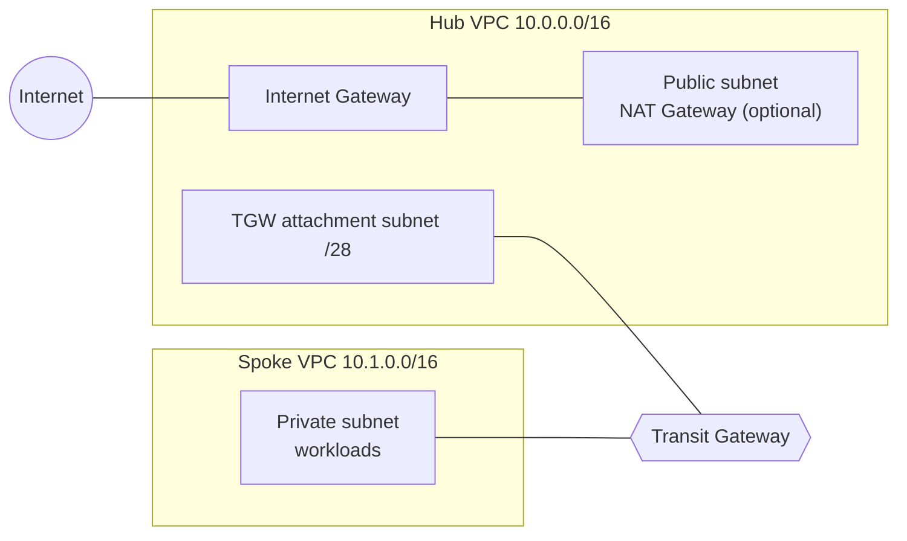

# Enterprise Cloud Network Automation

Hub-and-spoke network on AWS built entirely with Terraform: a central **hub VPC**, an isolated **spoke VPC** and an **AWS Transit Gateway** connecting them, with optional **centralized internet egress** through a NAT Gateway in the hub. Every change is validated by a CI pipeline (format, validation, TFLint and Checkov).

> **Status:** lab project, work in progress. See the roadmap for what is done and what is next.

## Architecture



**Traffic flows**

- **Spoke to hub:** the spoke route table sends the hub CIDR to the Transit Gateway.
- **Hub to spoke:** the hub public route table sends the spoke CIDR to the Transit Gateway.
- **Centralized egress (optional, `enable_nat_gateway = true`):** spoke traffic to `0.0.0.0/0` goes to the Transit Gateway, then to the hub attachment subnet, then through the NAT Gateway and the Internet Gateway. The return path uses the spoke route in the hub public route table.

## Repository layout

```
.
├── cloud-infrastructure/
│   ├── main.tf                    Root module: wiring, attachments and routes
│   ├── variables.tf / outputs.tf
│   └── modules/
│       ├── vpc-hub/               Hub VPC, subnets, route tables, IGW, optional NAT
│       ├── vpc-spoke/             Spoke VPC, private subnet, route table
│       └── transit-gateway/       Transit Gateway
│       └── test-instance/         Optional test workload (SSM access only, no SSH)
├── scripts/verify_connectivity.py Post-deploy verification (Python/boto3)
├── .github/workflows/validate.yml CI pipeline
└── .tflint.hcl                    TFLint configuration (terraform + AWS rulesets)
```

## Design decisions

- **Transit Gateway instead of VPC peering:** peering is non-transitive and needs a full mesh as the number of VPCs grows. A Transit Gateway scales as a single routing hub and allows central control of routes.
- **Dedicated /28 subnet for the TGW attachment:** keeps attachment network interfaces isolated from workloads and lets the attachment subnet have its own route table (used to send egress traffic to the NAT Gateway).
- **Single, optional NAT Gateway:** NAT Gateways are billed per hour, so the lab uses one, disabled by default.
- **Default security groups locked down:** no rules, so nothing is allowed unless a purpose-built security group is attached.
- **Separate `aws_route` resources:** routes are not defined inline in route tables, so the root module can add routes to tables created inside modules without conflicts.

## CI pipeline

On every push and pull request to `main`:

| Step | Purpose |
|---|---|
| `terraform fmt -check` | Consistent formatting |
| `terraform validate` | Syntax and internal consistency (no cloud credentials needed) |
| TFLint (terraform + AWS rulesets) | Best practices and provider-specific checks |
| Checkov | Security misconfiguration scanning |

Skipped Checkov checks are documented inline with the reason.

## Usage

```bash
cd cloud-infrastructure
terraform init
terraform plan
terraform apply
```

Requires Terraform >= 1.5 and AWS credentials configured locally. Set `-var="enable_nat_gateway=true"` to test centralized egress.

## Verification

After `terraform apply`, a Python script checks the deployment through the AWS API:

```bash
pip install -r scripts/requirements.txt
python scripts/verify_connectivity.py
```

It verifies that both Transit Gateway attachments are `available`, that the VPC route tables contain the expected routes through the Transit Gateway, and (with the test instance enabled) that the spoke leaves to the Internet with the public IP of the hub NAT Gateway, which proves the full centralized-egress path.

To run the complete test, including egress:

```bash
cd cloud-infrastructure
terraform apply -var="enable_nat_gateway=true" -var="deploy_test_instance=true"
cd .. && python scripts/verify_connectivity.py
```

The test instance has no public IP and no inbound rules; it is managed through AWS Systems Manager Session Manager.

## Cost and cleanup

The Transit Gateway attachments and the NAT Gateway are billed per hour. Destroy the lab after every session:

```bash
terraform destroy
```

## Roadmap

- [x] Hub VPC, spoke VPC and Transit Gateway with attachments
- [x] CI: fmt, validate, TFLint, Checkov
- [x] VPC routing and optional centralized egress (NAT Gateway)
- [x] Test instances in the spoke reachable only through SSM Session Manager (no SSH exposure)
- [ ] Connectivity tests (Python/boto3 and Ansible)
- [X] VPC Flow Logs
- [ ] Second spoke with custom Transit Gateway route tables (segmentation)
- [ ] Approval-gated apply/destroy from GitHub Actions using OIDC (no stored credentials)
