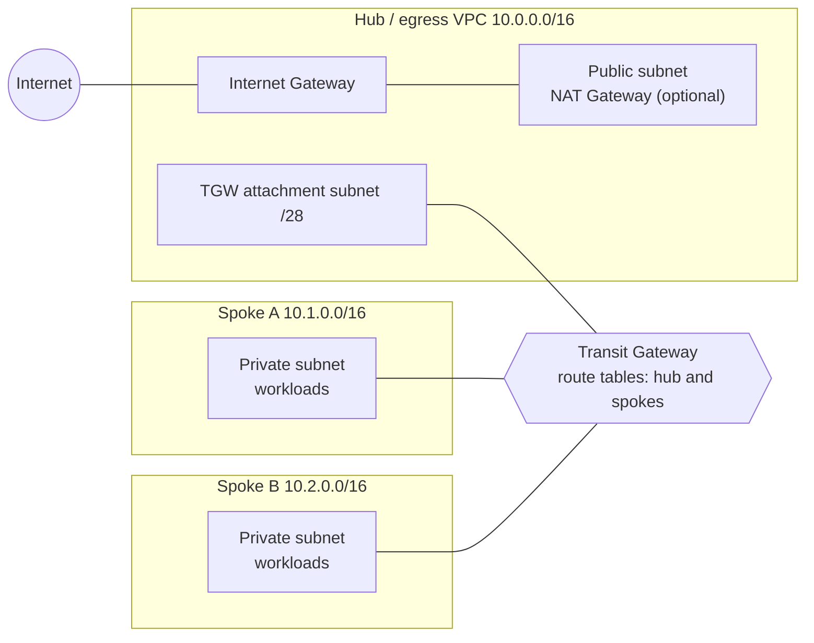

# Enterprise Cloud Network Automation

Hub-and-spoke network on AWS built entirely with Terraform: a shared **hub / egress VPC**, two **spoke VPCs** that are isolated from each other, and an **AWS Transit Gateway** with dedicated route tables that enforces the segmentation. It includes optional **centralized internet egress** through a NAT Gateway, SSM-only instance access (no SSH), KMS-encrypted **VPC Flow Logs**, a CI pipeline (format, validation, TFLint and Checkov) and a Python/boto3 script that verifies the deployment after every `apply`.

> **Status:** lab project, work in progress. See the roadmap for what is done and what is next.

## Architecture



In AWS the *hub* of a hub-and-spoke topology is the Transit Gateway itself. The "hub / egress VPC" is a shared-services VPC attached to it: it hosts the Internet Gateway and the optional NAT Gateway used for centralized egress.

**Traffic flows**

- **Spoke to hub:** each spoke route table sends the hub CIDR to the Transit Gateway.
- **Hub to spokes:** the hub public route table sends every spoke CIDR to the Transit Gateway.
- **Spoke to spoke:** blocked by default at the Transit Gateway (see Segmentation). Opt-in with `allow_spoke_to_spoke = true`.
- **Centralized egress (optional, `enable_nat_gateway = true`):** spoke traffic to `0.0.0.0/0` goes to the Transit Gateway, then to the hub attachment subnet, through the NAT Gateway and the Internet Gateway. The return path uses the spoke routes in the hub public route table.

## Segmentation with Transit Gateway route tables

Default route table association and propagation are **disabled** on the Transit Gateway. Every attachment is associated with, and propagates into, route tables that are declared explicitly:

| TGW route table | Associated with | Learns (propagation) | Static routes |
|---|---|---|---|
| `spokes` | every spoke attachment | the hub CIDR | `0.0.0.0/0` to the hub attachment (when egress is enabled) and one **blackhole** per spoke CIDR |
| `hub` | the hub attachment | every spoke CIDR | none |

Why the blackholes: with centralized egress the `spokes` table has a default route to the hub. Without a more specific route, spoke-to-spoke traffic would follow that default route. A blackhole for each spoke CIDR is more specific (longest-prefix match), so inter-spoke traffic is dropped at the Transit Gateway.

`allow_spoke_to_spoke = true` replaces the blackholes with propagations of every spoke into the `spokes` table, which opens the direct path through the Transit Gateway. The security group of the test instances allows ICMP in both directions between the lab CIDRs, so when the ping is blocked, the cause is the Transit Gateway and not a security group.

## Network design patterns and where this lab fits

| Pattern | How spoke-to-spoke traffic flows | Typical use |
|---|---|---|
| Flat Transit Gateway | A to TGW to B, no restrictions | Environments with the same trust level and no inspection requirement |
| **Segmented Transit Gateway (this lab)** | A to TGW to B only if the route tables allow it; otherwise dropped at the TGW | Separating production from development while sharing common services |
| Centralized inspection | A to TGW to inspection VPC (firewall, appliance mode) to TGW to B | Regulated environments that require east-west inspection |
| VPC peering / PrivateLink | Direct between two VPCs, or a single service exposed | Few VPCs, high-throughput pairs, or exposing one service |

This lab implements segmentation at the routing layer. It does **not** inspect the allowed traffic; centralized inspection is on the roadmap.

## Observability

All VPCs send VPC Flow Logs (accepted and rejected traffic) to a CloudWatch log group encrypted with a customer-managed KMS key (key rotation enabled, 365-day retention). The records use a custom format that adds `vpc-id`, `subnet-id`, the flow direction and the original packet addresses (`pkt-srcaddr` and `pkt-dstaddr`), which show the real source and destination behind the NAT Gateway and the Transit Gateway.

Example CloudWatch Logs Insights query to follow the traffic of one instance:

```
parse @message "* * * * * * * * * * * * * * * * * * *" as version, account, eni, src, dst, srcport, dstport, proto, packets, bytes, start, end, action, status, vpc, subnet, direction, pktsrc, pktdst
| filter pktsrc = "10.1.0.10" or pktdst = "10.1.0.10"
| sort @timestamp desc
| limit 30
```

## Repository layout

```
.
├── cloud-infrastructure/
│   ├── main.tf                    Root module: wiring, attachments, TGW segmentation and routes
│   ├── variables.tf / outputs.tf
│   └── modules/
│       ├── vpc-hub/               Hub / egress VPC, subnets, route tables, IGW, optional NAT
│       ├── vpc-spoke/             Spoke VPC, private subnet, route table
│       ├── transit-gateway/       Transit Gateway and its route tables (hub and spokes)
│       ├── flow-logs/             KMS key, log group and IAM role for VPC Flow Logs
│       └── test-instance/         Optional test workload (SSM access only, no SSH)
├── scripts/verify_connectivity.py Post-deploy verification (Python/boto3)
├── .github/workflows/validate.yml CI pipeline
└── .tflint.hcl                    TFLint configuration (terraform + AWS rulesets)
```

## Design decisions

- **Transit Gateway instead of VPC peering:** peering is non-transitive and needs a full mesh as the number of VPCs grows. A Transit Gateway scales as a single routing hub and allows central control of routes.
- **Explicit TGW route tables:** default association and propagation are disabled, so connectivity is a deliberate policy and not a side effect.
- **`for_each` over a `spokes` map:** adding a spoke is one line in `var.spokes`; attachments, routes, associations, blackholes and test instances follow automatically.
- **Dedicated /28 subnet for the TGW attachment:** keeps attachment network interfaces isolated from workloads and lets the attachment subnet have its own route table (used to send egress traffic to the NAT Gateway).
- **Single, optional NAT Gateway:** NAT Gateways are billed per hour, so the lab uses one, disabled by default.
- **SSM instead of SSH:** test instances have no public IP and no inbound rules; they are managed through AWS Systems Manager Session Manager.
- **Default security groups locked down:** no rules, so nothing is allowed unless a purpose-built security group is attached.
- **Separate `aws_route` resources:** routes are not defined inline in route tables, so the root module can add routes to tables created inside modules without conflicts.
- **Pinned availability zone:** the zone is built from the region and a suffix instead of a data source, so subnets are not recreated if AWS adds or reorders zones.

## CI pipeline

On every push and pull request to `main`:

| Step | Purpose |
|---|---|
| `terraform fmt -check` | Consistent formatting |
| `terraform validate` | Syntax and internal consistency (no cloud credentials needed) |
| TFLint (terraform + AWS rulesets) | Best practices and provider-specific checks |
| Checkov | Security misconfiguration scanning (no soft-fail) |

Skipped Checkov checks are documented inline with the reason.

## Usage

```bash
cd cloud-infrastructure
terraform init
terraform plan
terraform apply
```

Requires Terraform >= 1.5 and AWS credentials configured locally.

| Variable | Default | Purpose |
|---|---|---|
| `region` | `us-east-1` | AWS region |
| `az_suffix` | `a` | Availability zone letter appended to the region |
| `project` / `environment` | `enterprise-cloud-network-automation` / `lab` | Tags and name prefixes |
| `hub_vpc_cidr` | `10.0.0.0/16` | CIDR of the hub / egress VPC (/16) |
| `spokes` | `a` = `10.1.0.0/16`, `b` = `10.2.0.0/16` | Spoke VPCs, keyed by a short name (each a /16, no overlaps) |
| `enable_nat_gateway` | `false` | Hub NAT Gateway and centralized egress (billed per hour) |
| `deploy_test_instance` | `false` | One SSM-only test instance per spoke (requires `enable_nat_gateway`) |
| `allow_spoke_to_spoke` | `false` | Allow traffic between spokes through the Transit Gateway |

## Verification

After `terraform apply`, a Python script checks the deployment through the AWS API and exits with code 1 if any check fails:

```bash
pip install -r scripts/requirements.txt
python scripts/verify_connectivity.py
```

It verifies that:

1. Every Transit Gateway attachment (hub and spokes) is `available`.
2. The VPC route tables contain the expected routes through the Transit Gateway.
3. Each attachment is associated with the right TGW route table, and the `spokes` table holds blackhole routes (or propagated routes when `allow_spoke_to_spoke = true`).
4. VPC Flow Logs are active on every VPC.
5. With the test instances enabled: every spoke exits to the Internet with the public IP of the hub NAT Gateway, which proves the full centralized-egress path.
6. With two or more test instances: a ping between spokes is blocked, or succeeds when `allow_spoke_to_spoke = true`.

To run the complete test, including egress and isolation:

```bash
cd cloud-infrastructure
terraform apply -var="enable_nat_gateway=true" -var="deploy_test_instance=true"
cd .. && python scripts/verify_connectivity.py
```

Run it again with `-var="allow_spoke_to_spoke=true"` to check the opposite policy.

## Cost and cleanup

The Transit Gateway attachments, the NAT Gateway and the test instances are billed per hour. Destroy the lab after every session, using the same variables as the `apply`:

```bash
cd cloud-infrastructure
terraform destroy -var="enable_nat_gateway=true" -var="deploy_test_instance=true"
```

The KMS key used for the flow logs stays in "pending deletion" for 7 days (the minimum allowed), which is expected.

## Roadmap

- [x] Hub / egress VPC, spoke VPCs and Transit Gateway with attachments
- [x] CI: fmt, validate, TFLint, Checkov
- [x] VPC routing and optional centralized egress (NAT Gateway)
- [x] Test instances in the spokes reachable only through SSM Session Manager (no SSH exposure)
- [x] VPC Flow Logs (KMS-encrypted, custom format)
- [x] Two spokes with dedicated Transit Gateway route tables (segmentation)
- [x] Post-deploy verification with Python/boto3
- [ ] Post-deploy verification with Ansible
- [ ] Centralized inspection of spoke-to-spoke traffic (inspection VPC with appliance mode)
- [ ] Approval-gated apply/destroy from GitHub Actions using OIDC (no stored credentials)